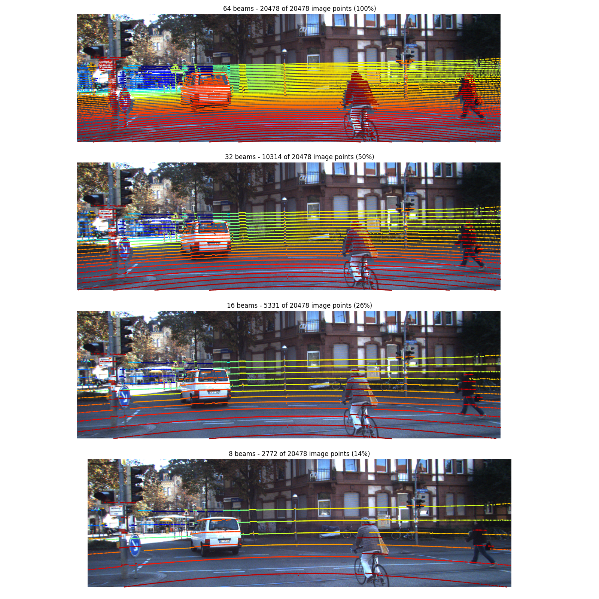
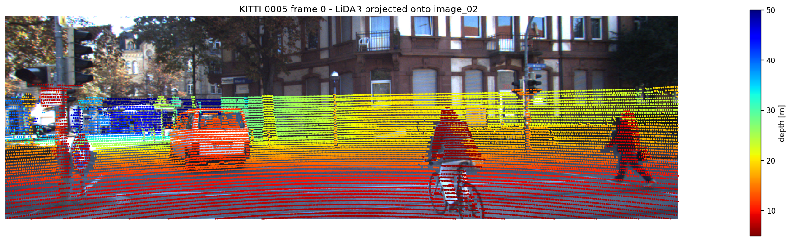
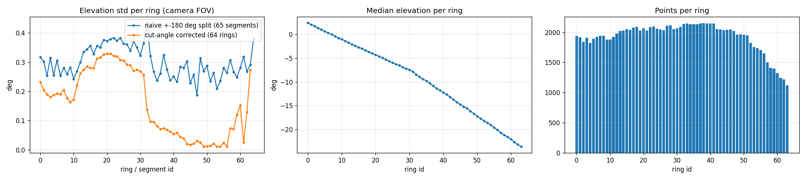
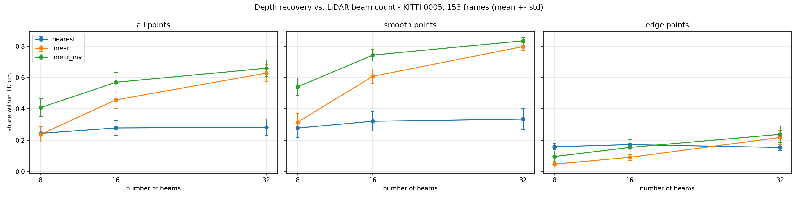
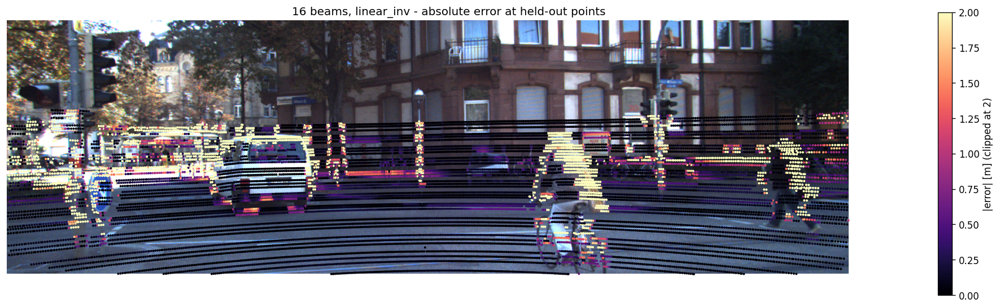

# BeamBudget-LiDAR

[](https://colab.research.google.com/github/CTRIYAS/BeamBudget-LiDAR/blob/main/beambudget_01.ipynb)

**How much depth information survives when a LiDAR loses beams?**

Using real Velodyne HDL-64E scans from KITTI, I remove whole laser rings to emulate
32-, 16- and 8-beam sensors, reconstruct the missing depth with simple image-plane
interpolation, and score the reconstruction against the held-out rings.

> **Scope.** This is a beam-*reduction* experiment on real scans, not a physical LiDAR
> simulator: it does not model the different beam angles, range noise or dropout of a
> native low-resolution sensor. The reference is the withheld LiDAR returns, not dense
> ground-truth scene depth.



## Pipeline

1. **Data.** KITTI raw `2011_09_26_drive_0005_sync` (154 frames): Velodyne scans and the
   left colour camera (`image_02`).
2. **Projection.** `P_rect_02 · R_rect_00 · T_velo→cam`, with sanity checks
   (orthonormal R, det(R) = +1, principal point inside the image, LiDAR x → camera z).
   20,478 of 123,397 points (16.6 %) fall inside the camera view in frame 0.
   
3. **Ring recovery.** KITTI `.bin` files carry no ring index. Points are stored laser by
   laser, but each sweep is cut **facing forward (azimuth ≈ 0°)**, not at ±180°.
   Splitting at the ±180° wrap gives 65 segments, each of which glues two lasers together
   *inside the camera view*. Correcting for the cut angle gives exactly 64 rings: the
   elevation spread per ring in the camera view drops from 0.29° to 0.17°, and the
   elevation profile is monotonic (an independent check, because ring IDs come from scan
   order, not elevation). Validated on 153 of 154 frames. Frame 153 is a truncated final
   sweep (98.5k points, bottom 11 lasers missing) and is excluded.
   
4. **Beam reduction.** Keep every 2nd, 4th or 8th ring (32 / 16 / 8 beams).
5. **Reconstruction.** Interpolate the kept points in the image plane:
   `nearest`, `linear` (Delaunay), and `linear_inv` (linear in 1/depth, which is exact
   for planar surfaces under perspective projection).
6. **Evaluation.** Held-out: predict depth at the pixels of the dropped-ring points and
   compare with their measured depth. Metrics: coverage, MAE, median error, P90, RMSE,
   share within 10 cm (`match_10cm`), δ < 1.05, runtime. Results are also split into
   *smooth* and *edge* points (edge = depth jump > 1 m to any of the 8 nearest projected
   neighbours in the full 64-beam scan; used for evaluation only, never by the methods).

## Results (153 frames, mean per frame)



**Smooth points, `linear_inv`:**

| Beams | Points kept | Median error | MAE | Within 10 cm |
|------:|------------:|-------------:|----:|-------------:|
| 32 | ~50 % | 4.1 cm | 8.5 cm | 83 % |
| 16 | ~26 % | 4.9 cm | 25 cm  | 74 % |
| 8  | ~14 % | 8.8 cm | 63 cm  | 54 % |

**Share within 10 cm, all points:**

| Beams | nearest | linear | linear_inv |
|------:|--------:|-------:|-----------:|
| 32 | 28 % | 63 % | 66 % |
| 16 | 28 % | 46 % | 57 % |
| 8  | 24 % | 24 % | 41 % |

### Findings

- **Surfaces survive; object boundaries don't.** On smooth points, 16 beams still give a
  4.9 cm median error. At edges, no method reaches more than 24 % within 10 cm at any beam
  count, and MAE stays at 3–5 m. Interpolation cannot know where one object ends and
  the background begins.
  
- **Inverse-depth interpolation helps more as data gets sparser.** On smooth points,
  `match_10cm` goes from `linear` to `linear_inv` as 0.80 → 0.83 (32 beams),
  0.61 → 0.74 (16) and 0.32 → 0.54 (8).
- **But it is not uniformly better.** `linear_inv` has a slightly *higher* RMSE than
  `linear` (e.g. 3.99 m vs 3.84 m at 16 beams): averaging 1/z pulls predictions toward
  the nearer surface, so misses at foreground/background edges are larger.
- **RMSE is a misleading headline here.** Overall RMSE is 3.5–5.7 m while the median
  error is 6–76 cm. Measured on frame 0 (16 beams, `linear_inv`): edge points are about
  25 % of the held-out points but account for about 97 % of the squared error
  (RMSE 10.2 m at edges vs 1.0 m on smooth points). So I report median and P90
  alongside RMSE.
- **At edges, copying beats blending.** At 8 and 16 beams, `nearest` gets more edge
  points within 10 cm (0.16 / 0.17) than `linear_inv` (0.10 / 0.15) or `linear`
  (0.05 / 0.09): it copies a real depth instead of inventing one between foreground and
  background.
- **Cost.** Interpolation time only (not loading, projection or ring assignment):
  `nearest` takes about 20–27 ms per frame and configuration, the linear methods
  70–300 ms, growing with the number of kept points (triangulation). Measured on a
  standard Colab CPU runtime.

### Robustness of the edge definition

The edge rule takes the 8 nearest projected neighbours without a distance limit. I
re-ran **frame 0 only** (16 beams, `linear_inv`) with the neighbours capped at a pixel radius
([`results/edge_sensitivity_frame0.csv`](results/edge_sensitivity_frame0.csv)):

| Radius cap | Edge share | Smooth MAE | Smooth ≤10 cm | Edge MAE | Edge ≤10 cm |
|-----------:|-----------:|-----------:|--------------:|---------:|------------:|
| none  | 25.8 % | 0.25 m | 68 % | 5.3 m | 9 % |
| 20 px | 25.8 % | 0.25 m | 68 % | 5.3 m | 9 % |
| 10 px | 25.8 % | 0.25 m | 68 % | 5.3 m | 9 % |
| 5 px  | 21.6 % | 0.36 m | 66 % | 5.7 m | 9 % |
| 3 px  | 10.2 % | 0.73 m | 59 % | 8.7 m | 3 % |

On this frame, capping the neighbourhood at 10 px or more did not change the edge
classification. At 3 px, neighbours on the adjacent ring fall outside the radius, real
vertical edges are missed and leak into the "smooth" class. At every radius tested,
edge error stays an order of magnitude above smooth error. Sensitivity across the full
sequence has not been evaluated yet.

## Limitations

- **All findings are specific to one sequence** (drive 0005, urban Karlsruhe). Its 153
  consecutive frames (~15 s) are strongly correlated, so the ± std across frames
  understates the true uncertainty, and other environments (highway, rural) may differ.
- Removing rings is not the same as simulating a native low-resolution sensor.
- The edge definition is a heuristic and flags about 26 % of points, including some
  noisy distant regions.
- Evaluation is only at withheld LiDAR returns, not on a dense depth map.

## Next steps

- More drives and the KITTI depth-completion split.
- Discontinuity-aware reconstruction, e.g. not interpolating across triangles whose
  corners differ strongly in depth, or using image edges as guidance.
- A learned depth-completion model as a comparison to these baselines.

## Repository

```
beambudget_01.ipynb   full pipeline, diagnostics and benchmark (Colab, CPU only)
figures/              figures used in this README
results/
  results_all_frames.csv               per frame × beams × method × region metrics
  summary_by_region_beams_method.csv   means over 153 frames
  edge_sensitivity_frame0.csv          edge-definition robustness check
requirements.txt
```

## Reproduce

Open `beambudget_01.ipynb` in Google Colab and run all cells. The first cell downloads
the KITTI drive and calibration (~30 s), and the full benchmark takes about 3 minutes on
a CPU runtime.

KITTI data © Geiger et al., *Vision meets Robotics: The KITTI Dataset*, IJRR 2013
(CC BY-NC-SA 3.0). The data is not redistributed here.

## License

Code is released under the [MIT License](LICENSE). The KITTI data used by the notebook is
not covered by this license and remains under its own CC BY-NC-SA 3.0 terms.
